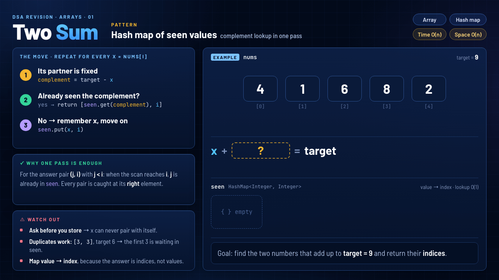

# 01 · Two Sum

`Arrays` · `Easy` · [LeetCode #1](https://leetcode.com/problems/two-sum/) · **Pattern: Hash map of seen values**



> **One-liner:** for each `x`, ask *"have I already seen `target − x`?"* Yes → answer found. No → remember `x` and move on.

## Problem

Given `nums` and `target`, return the **indices** of the two numbers that add up to `target`. Exactly one answer exists, and the same element can't be used twice.

## Approach: the move, repeated for every `x = nums[i]`

1. **Its partner is fixed:** `complement = target − x`, so there's nothing to search for.
2. **Already seen the complement?** If `seen` has it → `return [seen.get(complement), i]`.
3. **No → remember `x`:** `seen.put(x, i)` and move right.

## Why one pass is enough

Take the answer pair `(j, i)` with `j < i`. When the scan reaches `i`, `nums[j]` is already in `seen`, so every pair is caught at its **right** element. We never need to look back.

## Watch out

- **Check before you put.** An element can never pair with itself (`[3, 4]`, target `6` → `3` is not matched with `3`).
- **Duplicates work.** `[3, 3]`, target `6` → the first `3` is waiting in `seen` when the second one arrives.
- **Store `value → index`.** The answer is indices, not values.

## Complexity

| Time | Space |
|---|---|
| **O(n)**: one pass, O(1) average lookup | **O(n)**: the map holds up to `n` values |

## Recognize it next time

- Find a **pair** with a given **sum or difference** in an **unsorted** array, and return **indices** → keep a hash map of what you've seen.
- If the array is **sorted** and you only need values, two pointers do it in O(1) space.

## My solution · [`TwoSum.java`](TwoSum.java)

```java
class Solution {
    public int[] twoSum(int[] nums, int target) {
        Map<Integer, Integer> seen = new HashMap<>();

        for (int i = 0; i < nums.length; i++) {
            int complement = target - nums[i];
            if(seen.containsKey(complement)) {
                return new int[] {seen.get(complement),i};
            }
            seen.put(nums[i],i);
        }
        return new int[]{};
    }
}
```
