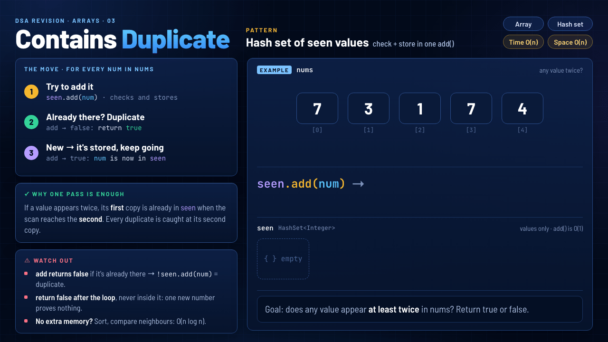
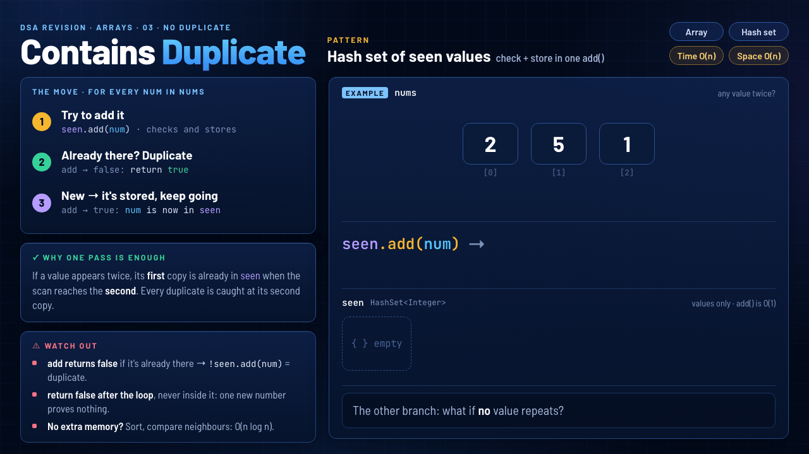

# 03 · Contains Duplicate

`Arrays` · `Easy` · [LeetCode #217](https://leetcode.com/problems/contains-duplicate/) · **Pattern: Hash set of seen values**



> **One-liner:** for each `num`, try `seen.add(num)`. `false` means it was already there → duplicate. If the loop finishes, every value was new → `false`.

## Problem

Given `nums`, return `true` if any value appears **at least twice**, and `false` if every element is distinct.

## Approach: the move, repeated for every `num`

1. **Try to add it:** `seen.add(num)` checks and stores in one call.
2. **Already there? Duplicate:** `add` returned `false` → `return true`.
3. **New → it's stored, keep going:** `add` returned `true`, so `num` is now in `seen`.

## Why one pass is enough

If a value appears twice, its **first** copy is already in `seen` when the scan reaches the **second**. Every duplicate is caught at its second copy, so we never look back.

## Watch out

- **`add` returns `false` if the value is already there.** So `!seen.add(num)` means "duplicate". It also saves the second hash lookup that `contains` + `add` would do.
- **`return false` goes after the loop, never inside it.** One new number proves nothing: an `else return false;` would answer `false` for `[2, 5, 2]` after looking at the first `2`.
- **No extra memory allowed?** Sort, then compare neighbours (`nums[i] == nums[i - 1]`): O(n log n) time with no set.

## Edge case: no value repeats



With `[2, 5, 1]`, every `seen.add` returns `true`, so the `if` never fires. Only when `i` reaches `nums.length` and the loop ends do we know there's no duplicate, which is why `return false` sits after the loop.

## Complexity

| Time | Space |
|---|---|
| **O(n)**: one pass, O(1) average `add` | **O(n)**: `seen` holds up to `n` values |

## Recognize it next time

- "Does anything repeat?", "first repeated element", "all unique?" → a hash set of what you've seen. It's the same `seen` idea as Two Sum, with a set instead of a map because you only need the values.
- If extra memory is not allowed, or the array is already sorted, compare neighbours instead.

## My solution · [`ContainsDuplicate.java`](ContainsDuplicate.java)

```java
class Solution {
    public boolean containsDuplicate(int[] nums) {
        Set<Integer> seen = new HashSet<>();
        for (int num : nums) {
            if (!seen.add(num)) {
                return true;
            }
        }
        return false;
    }
}
```
