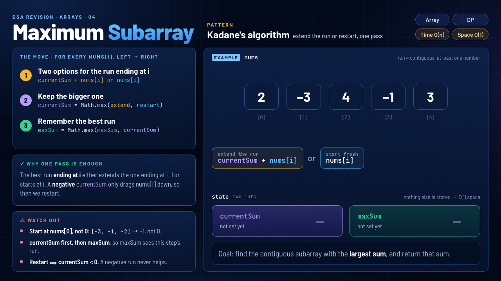
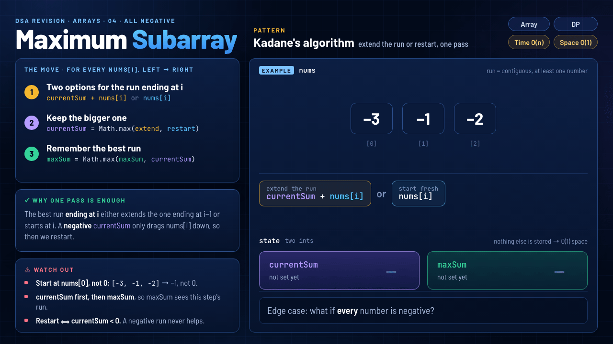

# 04 · Maximum Subarray

`Arrays` · `Medium` · [LeetCode #53](https://leetcode.com/problems/maximum-subarray/) · **Pattern: Kadane's algorithm**



> **One-liner:** at each `i`, the best run ending here is either the previous run extended (`currentSum + nums[i]`) or a fresh start (`nums[i]`). Keep the bigger one, and remember the best you ever saw in `maxSum`.

## Problem

Given `nums`, find the contiguous subarray (at least one element) with the largest sum, and return that sum.

## Approach: the move, for every `nums[i]` from left to right

Start with `currentSum = maxSum = nums[0]`.

1. **Two options for the run ending at `i`:** extend it, `currentSum + nums[i]`, or start fresh at `nums[i]`.
2. **Keep the bigger one:** `currentSum = Math.max(currentSum + nums[i], nums[i])`.
3. **Remember the best run:** `maxSum = Math.max(maxSum, currentSum)`.

## Why one pass is enough

The best run **ending at `i`** either extends the best run ending at `i − 1` or starts at `i`. There's no third option. A **negative** `currentSum` only drags `nums[i]` down, so that's exactly when restart wins. Every possible end point is checked once, and `maxSum` keeps the best of them.

## Watch out

- **Start at `nums[0]`, not `0`.** With `maxSum = 0`, the all-negative array `[-3, -1, -2]` would return `0`, but no subarray sums to 0. The answer is `-1`.
- **Update `currentSum` first, then `maxSum`**, so `maxSum` sees this step's run.
- **Restart ⟺ `currentSum < 0`.** A negative run never helps whatever comes next, but a run that only *dips* (like `4, −1` → `3`) is still worth keeping.

## Edge case: every number is negative



With `[-3, -1, -2]`, every step restarts, because each old run is negative. `maxSum` ends at `-1`, the single largest number. This is why both variables start at `nums[0]`: starting `maxSum` at `0` would return a sum no subarray has.

## Complexity

| Time | Space |
|---|---|
| **O(n)**: one pass, O(1) work per number | **O(1)**: just `currentSum` and `maxSum` |

## Recognize it next time

- "Maximum (or minimum) sum of a **contiguous** subarray" → Kadane. It's DP, `dp[i] = max(dp[i−1] + nums[i], nums[i])`, kept in a single variable.
- A common follow-up is to return the subarray itself: remember the start index whenever you restart, and save start and end whenever `maxSum` improves.
- Related variants: maximum product subarray (track the min too, because a negative flips the sign) and circular maximum subarray.

## My solution · [`MaximumSubarray.java`](MaximumSubarray.java)

```java
class Solution {
    public int maxSubArray(int[] nums) {
        int maxSum = nums[0];
        int currentSum = nums[0];

        for (int i = 1; i < nums.length; i++) {
            currentSum = Math.max(currentSum + nums[i], nums[i]);
            maxSum = Math.max(maxSum, currentSum);
        }
        return maxSum;
    }
}
```
