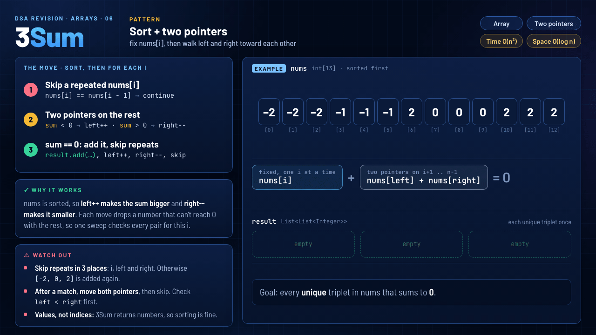

# 06 · 3Sum

`Arrays` · `Medium` · [LeetCode #15](https://leetcode.com/problems/3sum/) · **Pattern: Sort + two pointers**



> **One-liner:** sort, then for each `nums[i]` walk `left` and `right` toward each other: `sum < 0` → `left++`, `sum > 0` → `right--`, `sum == 0` → add it. Skipping repeated values at `i`, `left` and `right` keeps every triplet unique.

## Problem

Given `nums`, return every triplet `[nums[i], nums[j], nums[k]]` with three different indices that sums to `0`. The answer must not contain the same triplet twice, and the order doesn't matter. `3 ≤ nums.length ≤ 3000` and `−10⁵ ≤ nums[i] ≤ 10⁵`.

## Approach: sort, then the move for every `i`

1. **Skip a repeated `nums[i]`:** `if (i > 0 && nums[i] == nums[i - 1]) continue;`. The same first number would only find the same triplets again.
2. **Two pointers on the rest:** `left = i + 1`, `right = nums.length - 1`. If `sum < 0`, `left++` for a bigger number. If `sum > 0`, `right--` for a smaller one.
3. **`sum == 0`: add it, then skip repeats:** `result.add(...)`, move both pointers, then step past values equal to the ones just used.

## Why it works

After sorting, `left++` can only make the sum bigger and `right--` can only make it smaller. If `sum < 0`, even the biggest partner left, `nums[right]`, isn't enough for `nums[left]`, so `nums[left]` can't be in any triplet with this `i` and it's safe to drop. `sum > 0` drops `nums[right]` the same way. Every move rules out one number, so one sweep checks every pair for this `i` in O(n).

## Watch out

- **Skip repeats in three places: `i`, `left` and `right`.** In the GIF's example, without the `i` skip, `i = 1` would find `[-2, 0, 2]` again. Without the pointer skips, `[-2, 0, 2]` would be added once for every 0.
- **After a match, move both pointers, then skip.** Check `left < right` before reading `nums[left]` or `nums[right]`.
- **3Sum returns values, not indices**, so sorting is allowed. Two Sum has to return indices, which is why it uses a hash map instead.

## Complexity

| Time | Space |
|---|---|
| **O(n²)**: an O(n log n) sort, then an O(n) two-pointer sweep for each `i` | **O(log n)**: the recursion stack of `Arrays.sort` on an `int[]`. `result` is the output, so it isn't counted |

## Recognize it next time

- "Find all **unique** pairs, triplets or quadruplets with a given sum": sort + two pointers, and skip repeats. 4Sum adds one more outer loop, for O(n³).
- 3Sum Closest is the same sweep, but it tracks the sum closest to the target instead of an exact 0.
- The inner loop on its own is Two Sum II (sorted input). Two Sum on unsorted input needs indices, so it uses a hash map instead.
- Optional speed-up: `if (nums[i] > 0) break;` right after the skip. Once the smallest number is positive, no triplet can reach 0. The GIF's pass for `i = 9` is exactly that case.

## My solution · [`ThreeSum.java`](ThreeSum.java)

```java
class Solution {
    public List<List<Integer>> threeSum(int[] nums) {
        List<List<Integer>> result = new ArrayList<>();
        Arrays.sort(nums);

        for (int i = 0; i < nums.length - 2; i++) {
            // skip repeated number
            if (i > 0 && nums[i] == nums[i - 1]) {
                continue;
            }
            int left = i + 1;
            int right = nums.length - 1;

            while (left < right) {
                int sum = nums[i] + nums[left] + nums[right];
                if (sum == 0) {
                    result.add(Arrays.asList(nums[i], nums[left], nums[right]));
                    left++;
                    right--;
                    while (left < right && nums[left] == nums[left - 1]) {
                        left++;
                    }
                    while (left < right && nums[right] == nums[right + 1]) {
                        right--;
                    }
                } else if (sum < 0) {
                    left++;
                } else {
                    right--;
                }
            }
        }
        return result;
    }
}
```
