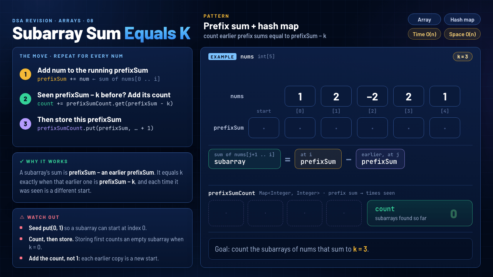

# 08 · Subarray Sum Equals K

`Arrays` · `Medium` · [LeetCode #560](https://leetcode.com/problems/subarray-sum-equals-k/) · **Pattern: Prefix sum + hash map**



> **One-liner:** keep a running `prefixSum`. A subarray ending at `i` sums to `k` exactly when an earlier prefix sum equals `prefixSum − k`, so add how many times that value was seen, then store the current `prefixSum`.

## Problem

Given `nums` and `k`, return how many contiguous, non-empty subarrays sum to `k`. `nums` can contain **negative** numbers. `1 ≤ nums.length ≤ 2·10⁴`, `−1000 ≤ nums[i] ≤ 1000`, `−10⁷ ≤ k ≤ 10⁷`.

## Approach: seed `put(0, 1)`, then the move for every `num`

1. **Add `num` to the running `prefixSum`:** it's now the sum of `nums[0 .. i]`.
2. **Seen `prefixSum − k` before? Add its count:** `if (prefixSumCount.containsKey(prefixSum - k)) count += prefixSumCount.get(prefixSum - k);`
3. **Then store this `prefixSum`:** `prefixSumCount.put(prefixSum, prefixSumCount.getOrDefault(prefixSum, 0) + 1);`

## Why it works

The sum of `nums[j+1 .. i]` is `prefixSum at i − prefixSum at j`. That equals `k` exactly when the earlier prefix sum is `prefixSum − k`. The map counts how many earlier positions `j` had that value, and each one is the start of a different subarray ending at `i`. In the GIF, `[2, 1] = 4 − 1 = 3`.

## Watch out

- **Seed `put(0, 1)`.** It stands for the empty prefix before index 0, so a subarray that starts at index 0 is counted. Without it, `[1, 2]` (`3 − 0`) is missed.
- **Count, then store.** If you store first, then when `k = 0` the current `prefixSum` matches itself and counts an empty subarray.
- **Add the count, not 1.** In the GIF, prefix sum `1` appears twice (after `[1]` and after `[1, 2, −2]`). So at `i = 4`, `prefixSum − k = 1` gives two subarrays: `[2, −2, 2, 1]` and `[2, 1]`.
- **Why not a sliding window:** with negative numbers, adding an element can make the sum smaller, so a window can't tell when to shrink. Prefix sums work for any sign.

## Complexity

| Time | Space |
|---|---|
| **O(n)**: one pass, O(1) average map lookups | **O(n)**: up to `n + 1` different prefix sums in `prefixSumCount` |

## Recognize it next time

- "Count the subarrays whose sum equals / is divisible by …", especially with negative numbers: prefix sum + a hash map of earlier prefix sums.
- Variants: Continuous Subarray Sum and Subarray Sums Divisible by K store `prefixSum % k`. Contiguous Array maps 0 to −1 and looks for a sum of 0. Longest Subarray with Sum K stores the **first index** of each sum instead of a count.
- It's the same "have I seen what I need?" lookup as Two Sum, except the value it looks for is `prefixSum − k`.

## My solution · [`SubarraySumEqualsK.java`](SubarraySumEqualsK.java)

```java
class Solution {
    public int subarraySum(int[] nums, int k) {
        Map<Integer, Integer> prefixSumCount = new HashMap<>();
        prefixSumCount.put(0, 1);   // empty prefix: lets a subarray start at index 0
        int count = 0;
        int prefixSum = 0;

        for (int num : nums) {
            prefixSum += num;
            if (prefixSumCount.containsKey(prefixSum - k)) {
                count += prefixSumCount.get(prefixSum - k);
            }
            prefixSumCount.put(prefixSum, prefixSumCount.getOrDefault(prefixSum, 0) + 1);
        }
        return count;
    }
}
```
