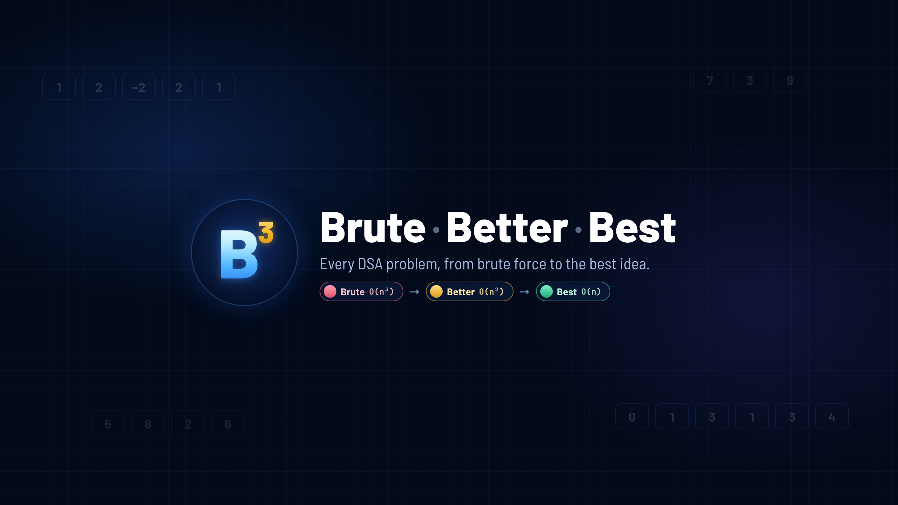

# Brute Better Best · DSA

Every DSA problem, from brute force to the best idea.

Each problem gets a narrated video on [YouTube @brutebetterbestdsa](https://www.youtube.com/@brutebetterbestdsa) that builds the answer the way you'd discover it: start with brute force, see what it wastes, make it better, then land on the optimal idea. This repo holds the Java solution and the revision notes for every problem.

**Solved: 19**

| Topic | # | Problem | Difficulty | Pattern |
|---|---|---|---|---|
| [Arrays](Arrays/) | 01 | [Two Sum](Arrays/01-two-sum/) | Easy | Hash map of seen values |
| [Arrays](Arrays/) | 02 | [Best Time to Buy and Sell Stock](Arrays/02-best-time-to-buy-and-sell-stock/) | Easy | Running max from the right |
| [Arrays](Arrays/) | 03 | [Contains Duplicate](Arrays/03-contains-duplicate/) | Easy | Hash set of seen values |
| [Arrays](Arrays/) | 04 | [Maximum Subarray](Arrays/04-maximum-subarray/) | Medium | Kadane's algorithm |
| [Arrays](Arrays/) | 05 | [Product of Array Except Self](Arrays/05-product-of-array-except-self/) | Medium | Prefix × suffix product |
| [Arrays](Arrays/) | 06 | [3Sum](Arrays/06-3sum/) | Medium | Sort + two pointers |
| [Arrays](Arrays/) | 07 | [Container With Most Water](Arrays/07-container-with-most-water/) | Medium | Two pointers from both ends |
| [Arrays](Arrays/) | 08 | [Subarray Sum Equals K](Arrays/08-subarray-sum-equals-k/) | Medium | Prefix sum + hash map |
| [Arrays](Arrays/) | 09 | [Set Matrix Zeroes](Arrays/09-set-matrix-zeroes/) | Medium | First row and column as flags |
| [Arrays](Arrays/) | 10 | [Spiral Matrix](Arrays/10-spiral-matrix/) | Medium | Four shrinking boundaries |
| [Arrays](Arrays/) | 11 | [Trapping Rain Water](Arrays/11-trapping-rain-water/) | Hard | Two pointers + water level |
| [Arrays](Arrays/) | 12 | [First Missing Positive](Arrays/12-first-missing-positive/) | Hard | Cyclic sort (index = value − 1) |
| [Sorting](Sorting/) | 01 | [Selection Sort](Sorting/01-selection-sort/) | Easy | Select the min, swap it to the front |
| [Strings](Strings/) | 01 | [Valid Anagram](Strings/01-valid-anagram/) | Easy | Frequency count array |
| [Strings](Strings/) | 02 | [Valid Palindrome](Strings/02-valid-palindrome/) | Easy | Two pointers from both ends |
| [Strings](Strings/) | 03 | [Longest Common Prefix](Strings/03-longest-common-prefix/) | Easy | Shrinking prefix length |
| [Strings](Strings/) | 04 | [Longest Substring Without Repeating Characters](Strings/04-longest-substring-without-repeating-characters/) | Medium | Sliding window + last-seen position |
| [Strings](Strings/) | 05 | [Group Anagrams](Strings/05-group-anagrams/) | Medium | Hash map with a letter-count key |
| [Strings](Strings/) | 06 | [Longest Repeating Character Replacement](Strings/06-longest-repeating-character-replacement/) | Medium | Sliding window + most frequent letter |
