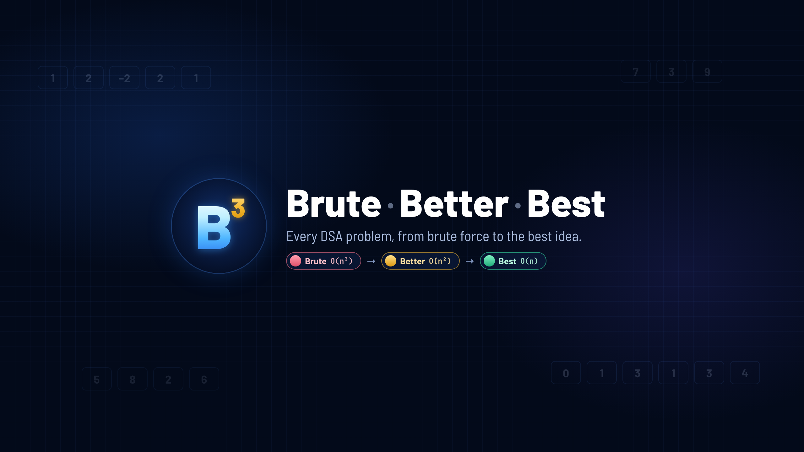

# Brute Better Best · DSA

Every DSA problem, from brute force to the best idea.

Each problem gets a narrated video on [YouTube @brutebetterbestdsa](https://www.youtube.com/@brutebetterbestdsa) that builds the answer the way you'd discover it: start with brute force, see what it wastes, make it better, then land on the optimal idea. This repo holds the Java solution and the revision notes for every problem.

**Solved: 9**

| Topic | # | Problem | Difficulty | Pattern |
|---|---|---|---|---|
| [Arrays](Arrays/) | 01 | [Two Sum](Arrays/01-two-sum/) | Easy | Hash map of seen values |
| [Arrays](Arrays/) | 02 | [Best Time to Buy and Sell Stock](Arrays/02-best-time-to-buy-and-sell-stock/) | Easy | Running max from the right |
| [Arrays](Arrays/) | 03 | [Contains Duplicate](Arrays/03-contains-duplicate/) | Easy | Hash set of seen values |
| [Arrays](Arrays/) | 04 | [Maximum Subarray](Arrays/04-maximum-subarray/) | Medium | Kadane's algorithm |
| [Arrays](Arrays/) | 05 | [Product of Array Except Self](Arrays/05-product-of-array-except-self/) | Medium | Prefix × suffix product |
| [Arrays](Arrays/) | 06 | [3Sum](Arrays/06-3sum/) | Medium | Sort + two pointers |
| [Arrays](Arrays/) | 07 | [Container With Most Water](Arrays/07-container-with-most-water/) | Medium | Two pointers from both ends |
| [Arrays](Arrays/) | 08 | [Subarray Sum Equals K](Arrays/08-subarray-sum-equals-k/) | Medium | Prefix sum + hash map |
| [Sorting](Sorting/) | 01 | [Selection Sort](Sorting/01-selection-sort/) | Easy | Select the min, swap it to the front |
