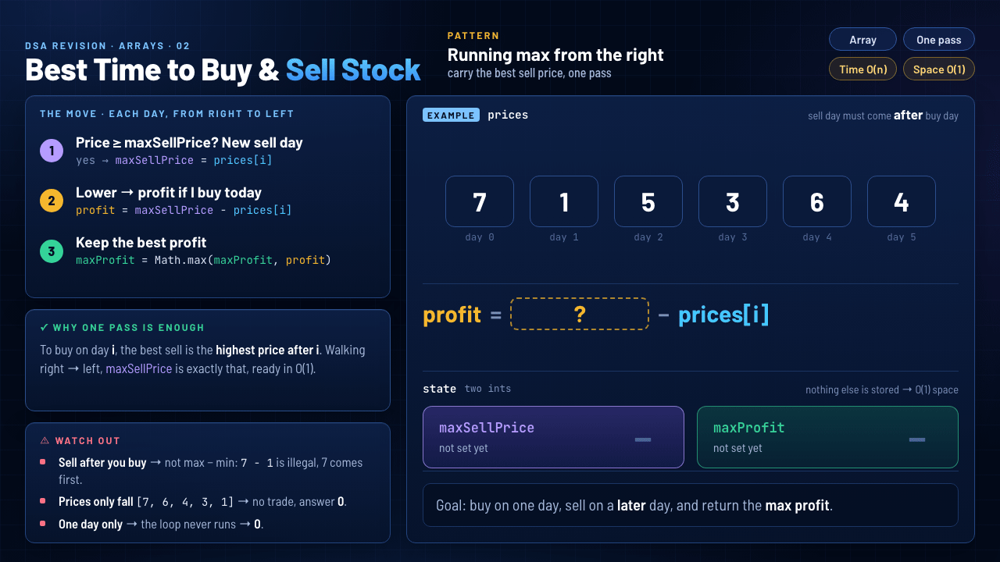

# 02 · Best Time to Buy and Sell Stock

`Arrays` · `Easy` · [LeetCode #121](https://leetcode.com/problems/best-time-to-buy-and-sell-stock/) · **Pattern: Running max from the right**



> **One-liner:** walk right → left carrying `maxSellPrice`, the highest price on a later day. Each day is either a new sell day or a buy day worth `maxSellPrice − prices[i]`.

## Problem

`prices[i]` is the stock price on day `i`. Buy on one day and sell on a **later** day. Return the maximum profit, or `0` if no trade makes money.

## Approach: the move, for each day from right to left

Start with `maxSellPrice = prices[n − 1]` (the last day is the only sell option) and `maxProfit = 0`.

1. **Price ≥ `maxSellPrice`? New sell day:** `maxSellPrice = prices[i]`. Every earlier day would rather sell here.
2. **Lower → profit if I buy today:** `maxSellPrice − prices[i]`.
3. **Keep the best profit:** `maxProfit = Math.max(maxProfit, maxSellPrice − prices[i])`.

## Why one pass is enough

To buy on day `i`, the best sell is the highest price **after** `i`. Walking right → left, `maxSellPrice` is exactly that, so each day is answered in O(1) instead of scanning every later day.

## Watch out

- **Sell after you buy.** It isn't `max − min` of the array: in `[7, 1, 5, 3, 6, 4]`, `7 − 1` is illegal because 7 comes first. Starting from the last day keeps every sell to the right of its buy.
- **Prices only fall** (`[7, 6, 4, 3, 1]`): every day is a new high, the else branch never runs, and the answer stays `0`.
- **One day only:** the loop never runs → `0`. (An empty array would throw at `prices[prices.length − 1]`, but LeetCode guarantees at least one day.)

## Complexity

| Time | Space |
|---|---|
| **O(n)**: one pass, O(1) work per day | **O(1)**: just `maxSellPrice` and `maxProfit` |

## Recognize it next time

- "Best pair `(i, j)` with `i < j`", where the value depends on one element and the **best element after it** (or before it) → carry a running max/min in one pass instead of trying every pair.
- The mirror version is the one most editorials show: scan left → right, keep `minPrice` (the cheapest buy so far), and ask "what if I sell today?". Same idea, same cost.

## My solution · [`BestTimeToBuyAndSellStock.java`](BestTimeToBuyAndSellStock.java)

```java
class Solution {
    public int maxProfit(int[] prices) {
        int maxProfit = 0;
        int maxSellPrice = prices[prices.length - 1];

        for (int i = prices.length - 2; i >= 0; i--) {
            if (prices[i] >= maxSellPrice) {
                maxSellPrice = prices[i];
            } 
            else {
                maxProfit = Math.max (maxProfit, maxSellPrice - prices[i]);
            }
        }
        return maxProfit;
    }
}
```
